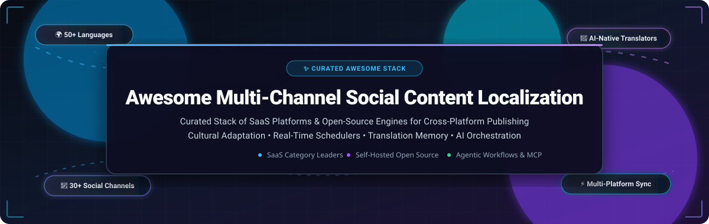

<p align="center">
  
</p>

<p align="center">
  <a href="https://github.com/ishandutta2007/Awesome-Awesome-Awesome"></a>
  <a href="https://discord.gg/jc4xtF58Ve"></a>
  <a href="https://github.com/ishandutta2007/Awesome-Multi-Channel-Social-Content-Localization-Tools/stargazers"></a>
  <a href="https://github.com/ishandutta2007/Awesome-Multi-Channel-Social-Content-Localization-Tools/network/members"></a>
  <a href="https://github.com/ishandutta2007/Awesome-Multi-Channel-Social-Content-Localization-Tools/pulls"></a>
  <a href="https://github.com/ishandutta2007/Awesome-Multi-Channel-Social-Content-Localization-Tools/blob/main/LICENSE"></a>
  <a href="https://github.com/ishandutta2007"></a>
</p>

---

# 🌐 Awesome Multi-Channel Social Content Localization Tools 🚀

> A comprehensive, SEO-optimized directory of **SaaS platforms** and **open-source repositories** designed for **Multi-Channel Social Content Localization**, cross-platform social media publishing, translation memory systems (TMS), AI translation pipelines, and international cultural adaptation.

Whether you are scaling social presence across 30+ networks (X/Twitter, LinkedIn, Instagram, TikTok, YouTube, Threads, Bluesky, Pinterest, WeChat, Telegram) or localizing content into 50+ languages while preserving tone of voice, this curated stack showcases the leading enterprise solutions and self-hosted tools available today.

---

## 📑 Table of Contents
- [📊 Sector Overview & Market Dynamics](#-sector-overview--market-dynamics)
- [🏢 SaaS & Hosted Platforms](#-saas--hosted-platforms)
- [💻 Open-Source Repositories (Ranked by Stars)](#-open-source-repositories-ranked-by-stars)
- [🛠️ Recommended Architecture Blueprint](#️-recommended-architecture-blueprint)
- [🤝 How to Contribute](#-how-to-contribute)
- [⭐ Star History](#-star-history)
- [💖 Support & Community](#-support--community)
- [⚖️ Disclaimer & Compliance](#️-disclaimer--compliance)

---

## 📊 Sector Overview & Market Dynamics

The global market for social media management platforms and localization software is projected to surpass **$28.5 Billion by 2028**, expanding at a compound annual growth rate (CAGR) of **16.8%**. The explosive rise of cross-border e-commerce, global creator economies, and real-time localized customer engagement has propelled multi-channel content adaptation from an ad-hoc translation exercise into an essential continuous marketing pipeline.

The sector exhibits **moderate fragmentation**: while enterprise giants such as **Contentful**, **Sprinklr**, and **Sprout Social** dominate Fortune 500 omnichannel governance and large-scale listening operations, the advent of AI translation engines (LLMs, DeepL, Cohere), Model Context Protocol (MCP) coding agents, and headless content architectures has fostered a vibrant, competitive ecosystem. Category specialists like **Phrase**, **Lokalise**, and **Smartcat** command high-velocity digital localization workflows, while self-hosted open-source platforms like **Postiz**, **VideoLingo**, and **Mixpost** deliver data sovereignty and zero seat-fee alternatives for developers, agencies, and security-conscious global organizations. Consequently, the industry avoids a winner-take-all monopoly and instead thrives on modular API-driven interoperability.

---

## 🏢 SaaS & Hosted Platforms

The table below lists the prominent SaaS platforms for multi-channel social content localization and cross-network management, **sorted descending by company size** (market capitalization / enterprise valuation and ARR):

| 🏢 Platform | 💰 Company Size (Valuation / Revenue) | 🏷️ Starting Tier Pricing | 🎁 Free Tier / Trial Limits | 🔍 Core Capabilities & Localization Focus |
| :--- | :--- | :--- | :--- | :--- |
| **[Contentful](https://www.contentful.com/)** | **~$3.0B Valuation** (Series F) <br>• ~$200M+ ARR | **$300/month** <br>*(Lite Plan with 20 users & 1M API calls)* | **Free Forever Plan**: 1 Starter Space, up to 10 users, 100k API calls/mo, 50 GB CDN bandwidth, 2 locales max (hard usage cap) | Composable headless content platform with native multi-locale workflows, DeepL/Phrase connectors, and automated social distribution webhooks. |
| **[Sprinklr](https://www.sprinklr.com/)** | **~$2.1B Market Cap** (NYSE: CXM) <br>• ~$732M Annual Revenue | **~$4,167/month** <br>*(Billed annually at $50,000 base contract)* | **30-day Proof-of-Concept (PoC) sandbox trial** arranged via consultative sales qualification (self-serve tier discontinued) | Unified enterprise CXM & social suite across 30+ channels with AI translation, real-time cultural listening, compliance guardrails, and asset governance. |
| **[Sprout Social](https://sproutsocial.com/)** | **~$1.9B Market Cap** (NASDAQ: SPT) <br>• ~$390M Annual Revenue | **$199/seat/month** <br>*(Standard plan, billed annually; $249 mo/mo)* | **30-day full-featured free trial** with no credit card required; includes up to 5 social profiles and core scheduling/analytics tools | Enterprise social management platform with multi-language sentiment analysis, centralized inbox, approval trees, and cross-channel publishing. |
| **[Hootsuite](https://www.hootsuite.com/)** | **~$1.0B+ Valuation** (Acquired Talkwalker) <br>• ~$280M Annual Revenue | **$99/user/month** <br>*(Standard plan, billed annually)* | **30-day free trial** for 1 user and 10 social profiles with unlimited scheduling (credit card required for verification) | Established multi-network scheduler featuring OwlyWriter AI for multilingual content variations, social listening, and unified engagement feeds. |
| **[Lokalise](https://lokalise.com/)** | **~$1.0B Valuation** (Series B Unicorn) <br>• ~$55M+ ARR | **$144/month** <br>*(Explorer plan; $170 mo/mo)* | **14-day free trial** with no credit card required; includes 5 projects, 10 languages, 60,000 processed words, and Enterprise preview | Developer-centric localization platform with OAuth-driven GitHub/GitLab sync, unified glossaries, style guides, and Lokalise AI translation workflows. |
| **[Smartling](https://www.smartling.com/)** | **~$600M Valuation** ($160M growth equity) <br>• ~$70M+ ARR | **$200/month** <br>*(Base platform estimate; MT from $0.0075/word, AI from $0.06/word)* | **Free Core Plan Forever**: CAT tool with visual context, drag-and-drop docs, 180-day translation memory, and pay-as-you-go MT/AI translation | AI Translation Cloud with AI Hub routing across 20+ machine translation and LLM engines, visual context editors, and direct headless CMS connectors. |
| **[Phrase](https://phrase.com/)** | **~$450M Valuation** (Carlyle Group / Memsource) <br>• ~$75M+ ARR | **$27/seat/month** <br>*(Freelancer plan; Team TMS from $1,245/mo)* | **14-day free trial** of Language Intelligence Platform / TMS with no credit card required; capacity-capped during trial period | Enterprise translation management with Phrase Orchestrator automated routing, 200+ integrations (Contentful, Notion, Braze), and native MCP server for AI coding agents. |
| **[Smartcat](https://www.smartcat.com/)** | **~$120M Valuation** (Series B, Matrix) <br>• ~$22M+ ARR | **$100/month** <br>*(Billed annually at $1,200/yr for 300,000 Smartwords)* | **Free Forever Plan**: unlimited team users, unlimited projects, unlimited TM storage, and CAT editor with introductory Smartword AI credits | AI language platform with specialized AI social media agents capable of drafting, translating, and scheduling localized posts with 70% lower campaign costs. |
| **[Transifex](https://www.transifex.com/)** | **~$100M Valuation** (PARC / Emerson) <br>• ~$18M+ ARR | **$135/month** <br>*(Starter plan billed annually; $160 mo/mo)* | **15-day free trial** with no credit card required; allows up to 50,000 hosted words and full collaboration access to Starter/Growth tier features | Continuous localization platform featuring Translation Quality Index (TQI) automated scoring, DeepL/Google MT integrations, and PII/GDPR compliance. |
| **[Buffer](https://buffer.com/)** | **~$70M Valuation** (Transparent metrics) <br>• ~$22M ARR | **$5/channel/month** <br>*(Essentials plan billed annually; $6/ch/mo mo/mo)* | **Free Forever Plan**: up to 3 connected social channels, 10 scheduled posts per channel queue limit, 1 user, basic AI assistant, and 30-day analytics | Creator-friendly social media management tool with visual calendar, multi-channel scheduling, Start Page link-in-bio, and AI text rephrasing. |

---

## 💻 Open-Source Repositories (Ranked by Stars)

Self-hosting open-source schedulers and localization engines provides total data sovereignty, custom API routing, and freedom from per-seat SaaS costs. Below are top repositories **sorted descending by GitHub Stars_Count**, each equipped with a live Stars_Badge linking to its stargazers page:

1. ### 📨 [Postiz](https://github.com/gitroomhq/postiz-app) [](https://github.com/gitroomhq/postiz-app/stargazers)
   - **Stack & License:** TypeScript, Next.js, Node.js, Prisma, Redis, Docker • **AGPL-3.0**
   - **Stars:** **37,100+**
   - **Highlights:** The ultimate open-source, agentic social media scheduling tool. Supports official APIs across X/Twitter, LinkedIn, YouTube, TikTok, Reddit, Pinterest, and Facebook. Self-hostable via Docker with community plugins and AI post generation.

2. ### 🎬 [VideoLingo](https://github.com/Huanshere/VideoLingo) [](https://github.com/Huanshere/VideoLingo/stargazers)
   - **Stack & License:** Python, Streamlit, Whisper-timestamped, NLP/LLM, FFmpeg • **Apache-2.0**
   - **Stars:** **18,700+**
   - **Highlights:** Netflix-quality video translation, dubbing, and localization pipeline for international social media creators. Features Whisper transcription, LLM-guided context-aware translation, precise subtitle alignment, and multi-language voice cloning for YouTube, TikTok, and Reels.

3. ### 🌐 [LibreTranslate](https://github.com/LibreTranslate/LibreTranslate) [](https://github.com/LibreTranslate/LibreTranslate/stargazers)
   - **Stack & License:** Python, Argos Translate, Flask, Docker • **AGPL-3.0**
   - **Stars:** **17,000+**
   - **Highlights:** Free and open-source self-hosted machine translation API. 100% offline capable with no third-party API dependencies. Perfect for automated real-time social content translation and on-premise localized text batching.

4. ### 📚 [Argos Translate](https://github.com/argosopentech/argos-translate) [](https://github.com/argosopentech/argos-translate/stargazers)
   - **Stack & License:** Python, OpenNMT, CTranslate2 • **MIT / Open**
   - **Stars:** **6,500+**
   - **Highlights:** Open-source offline translation library and engine powering LibreTranslate. Provides downloadable language packages and a clean Python API for building custom localization microservices and automated social translation bots.

5. ### 📝 [Weblate](https://github.com/WeblateOrg/weblate) [](https://github.com/WeblateOrg/weblate/stargazers)
   - **Stack & License:** Python, Django, Celery, PostgreSQL, Docker, K8s • **GPL-3.0**
   - **Stars:** **6,100+**
   - **Highlights:** Web-based continuous localization platform featuring deep version control integration (Git, Mercurial, Subversion). Includes automated translation propagation, glossary management, quality checks, and multi-branch synchronization.

6. ### 🔤 [Tolgee](https://github.com/tolgee/tolgee-platform) [](https://github.com/tolgee/tolgee-platform/stargazers)
   - **Stack & License:** Kotlin, Spring Boot, TypeScript, React, Docker • **Apache-2.0**
   - **Stars:** **4,100+**
   - **Highlights:** Modern web-based localization platform with in-context translation, automatic screenshot generation, and integrations with Deepl, AWS Translate, and Google Cloud Translation. Delivers an intuitive CAT tool for distributed content teams.

7. ### 📅 [Mixpost](https://github.com/inovector/mixpost) [](https://github.com/inovector/mixpost/stargazers)
   - **Stack & License:** PHP, Laravel, Vue.js, Tailwind CSS, MySQL • **MIT / AGPL-3.0**
   - **Stars:** **3,800+**
   - **Highlights:** Battle-tested self-hosted social media management software for PHP and Laravel environments. Supports multiple brands, unlimited scheduling, engagement metrics, and social publishing across X, Facebook, Instagram, LinkedIn, Mastodon, and YouTube.

8. ### 🗃️ [Ever Traduora](https://github.com/ever-co/ever-traduora) [](https://github.com/ever-co/ever-traduora/stargazers)
   - **Stack & License:** TypeScript, Node.js, Angular, MySQL, Docker • **AGPL-3.0**
   - **Stars:** **2,100+**
   - **Highlights:** Open-source translation management platform designed for cross-functional teams. Provides REST API access, role-based access control (RBAC), translation memory, and multi-project phrase localization.

9. ### 🌍 [Inlang](https://github.com/opral/inlang) [](https://github.com/opral/inlang/stargazers)
   - **Stack & License:** TypeScript, Web Standards, Svelte • **Apache-2.0**
   - **Stars:** **2,000+**
   - **Highlights:** Open-format TMS ecosystem centered around the `.inlang` project file. Offers developer-grade SDKs, CLI utilities, and plugins for i18next, JSON, and XLIFF to integrate localized marketing copy directly into codebases and CI/CD pipelines.

10. ### 📊 [Socioboard 5.0](https://github.com/Socioboard-developers/Socioboard-5.0) [](https://github.com/Socioboard-developers/Socioboard-5.0/stargazers)
    - **Stack & License:** Node.js, React, Express, MongoDB, Android/iOS • **GPL-3.0**
    - **Stars:** **1,500+**
    - **Highlights:** Full-stack social media management, lead generation, and social CRM platform with native mobile applications. Features automated message feeds, content discovery, sentiment tracking, and multi-network publishing.

11. ### ⚡ [Accent](https://github.com/mirego/accent) [](https://github.com/mirego/accent/stargazers)
    - **Stack & License:** Elixir, Phoenix, GraphQL, PostgreSQL, Docker • **BSD-3-Clause**
    - **Stars:** **1,400+**
    - **Highlights:** First-class developer-oriented translation tool with asynchronous review flows, Slack notifications, string history tracking, and a powerful GraphQL API for international content automation.

12. ### 🚀 [TryPost](https://github.com/trypostit/trypost) [](https://github.com/trypostit/trypost/stargazers)
    - **Stack & License:** TypeScript, Next.js, PostgreSQL • **MIT**
    - **Stars:** **700+**
    - **Highlights:** Lightweight open-source social media scheduling application designed for creators and startups seeking a clean alternative to Buffer and Hootsuite.

13. ### 📤 [Easy Uploader](https://github.com/wanghaisheng/easy-uploader) [](https://github.com/wanghaisheng/easy-uploader/stargazers)
    - **Stack & License:** Python, Playwright, Selenium, Celery • **MIT**
    - **Stars:** **380+**
    - **Highlights:** Headless multi-channel video uploader and publisher. Automates batch video scheduling across TikTok, YouTube Shorts, Instagram Reels, Xiaohongshu, Bilibili, and Douyin for cross-border content creators.

14. ### ☁️ [Cogsend](https://github.com/cogsend/cogsend) [](https://github.com/cogsend/cogsend/stargazers)
    - **Stack & License:** TypeScript, Cloudflare Workers, Hono, D1 • **MIT**
    - **Stars:** **220+**
    - **Highlights:** Serverless self-hosted social media scheduler deploying directly to your Cloudflare account. Write once and broadcast to connected social networks with zero server hosting costs.

15. ### 🦞 [SocialClaw](https://github.com/ndesv21/socialclaw) [](https://github.com/ndesv21/socialclaw/stargazers)
    - **Stack & License:** TypeScript, Node.js, OpenClaw • **MIT**
    - **Stars:** **90+**
    - **Highlights:** Social media scheduling CLI and agentic skill tailored for autonomous AI agents. Enables programmatic posting and multilingual distribution to X, LinkedIn, Instagram, Facebook, TikTok, Discord, Telegram, and Pinterest.

16. ### 🛡️ [Postmill](https://github.com/postmill-ai/postmill-app) [](https://github.com/postmill-ai/postmill-app/stargazers)
    - **Stack & License:** TypeScript, Next.js, NestJS, PostgreSQL, Inngest, Docker • **AGPL-3.0**
    - **Stars:** **20+**
    - **Highlights:** AI-native social management platform for 45+ networks with BYOK LLM support across 30+ providers. Features 46 built-in creative studios, a 16-language localized UI, cross-network unified comments, and 90-permission RBAC.

17. ### 🤖 [Posthive](https://github.com/AstaBlackClove/posthive) [](https://github.com/AstaBlackClove/posthive/stargazers)
    - **Stack & License:** TypeScript, FastMCP, Python • **MIT**
    - **Stars:** **18**
    - **Highlights:** Agentic social media scheduler featuring a built-in Model Context Protocol (MCP) server, allowing local coding agents and LLMs to draft, localize, and publish social posts across multiple networks automatically.

18. ### 📡 [PostSider](https://github.com/lumizone/postsider) [](https://github.com/lumizone/postsider/stargazers)
    - **Stack & License:** TypeScript, NestJS, Next.js, Prisma, Redis, Temporal • **AGPL-3.0**
    - **Stars:** **11**
    - **Highlights:** Open-source social scheduling platform for 30+ networks equipped with a public REST API, Node.js SDK, and Temporal-driven durable scheduling workflows to prevent dropped posts during traffic spikes.

19. ### 🧠 [Free AI Social Media Scheduler](https://github.com/Anil-matcha/Free-AI-Social-Media-Scheduler) [](https://github.com/Anil-matcha/Free-AI-Social-Media-Scheduler/stargazers)
    - **Stack & License:** TypeScript, Next.js 16, PostgreSQL, Prisma, Stripe • **MIT**
    - **Stars:** **5**
    - **Highlights:** Free self-hostable AI scheduler supporting YouTube, TikTok, Instagram, Facebook, X, LinkedIn, and Threads. Incorporates conversational memory to draft platform-tailored localized copy with one click.

20. ### 🎨 [Brightbean Studio](https://github.com/rmdes/brightbean-studio) [](https://github.com/rmdes/brightbean-studio/stargazers)
    - **Stack & License:** PHP, Docker, OAuth • **AGPL-3.0**
    - **Stars:** **0**
    - **Highlights:** Lightweight self-hostable dashboard for scheduling and publishing across 10+ networks with comprehensive OAuth setup guides for personal Instagram accounts and Facebook Pages.

---

## 🛠️ Recommended Architecture Blueprint

To build a **100% self-hosted, scalable multilingual social media localization pipeline**:

```text
┌────────────────────────────────────────────────────────┐
│           1. Content Ideation & Headless CMS           │
│        (Contentful / Inlang .inlang project / Git)     │
└──────────────────────────┬─────────────────────────────┘
                           │
                           ▼
┌────────────────────────────────────────────────────────┐
│      2. Translation Memory & AI Localization Engine    │
│  (LibreTranslate / VideoLingo / Weblate / Tolgee API)  │
└──────────────────────────┬─────────────────────────────┘
                           │
                           ▼
┌────────────────────────────────────────────────────────┐
│        3. Cross-Platform Scheduling & Dispatch         │
│     (Postiz / Mixpost / Postmill / PostSider APIs)     │
└──────────────────────────┬─────────────────────────────┘
                           │
       ┌───────────────────┼───────────────────┐
       ▼                   ▼                   ▼
📱 TikTok / Reels    💼 LinkedIn / X     🌐 Fediverse / Web
 (Localized Audio)   (B2B Multilingual)   (Bluesky / Mastodon)
```

1. **Ingestion & TMS**: Maintain master copy in an open-format TMS like [Inlang](https://github.com/opral/inlang) or [Weblate](https://github.com/WeblateOrg/weblate).
2. **Translation Layer**: Route text strings through [LibreTranslate](https://github.com/LibreTranslate/LibreTranslate) or [Argos Translate](https://github.com/argosopentech/argos-translate); handle localized video and subtitles via [VideoLingo](https://github.com/Huanshere/VideoLingo).
3. **Execution Layer**: Dispatch formatted channel-specific variants via [Postiz](https://github.com/gitroomhq/postiz-app) or [Mixpost](https://github.com/inovector/mixpost).

---

## 🤝 How to Contribute

Contributions from developers, localization engineers, and marketing professionals are warmly welcomed!

1. 🍴 **Fork the repository** to your GitHub account.
2. 🌿 **Create a feature branch**: `git checkout -b feature/add-new-tool`.
3. 📝 **Add or update entries**: Ensure each tool includes a factual description, pricing or Stars_Badge, and verified links.
4. 🔍 **Verify formatting**: Check table alignment and Markdown links.
5. 🚀 **Submit a Pull Request**: Detail your changes and why the tool fits multi-channel social localization.

---

## ⭐ Star History

[](https://star-history.dera.page/#ishandutta2007/Awesome-Multi-Channel-Social-Content-Localization-Tools&type=date&legend=top-left)

---

## 💖 Support & Community

Thank you for exploring this curated directory! If this resource saved you time or aided your international content workflow, please consider:

- ⭐ **Starring this repository** on GitHub to support discoverability.
- 🍴 **Forking and sharing** with your engineering and marketing networks.
- 💬 **Joining the discussion** on [Discord](https://discord.gg/jc4xtF58Ve) for real-time collaboration.
- ☕ **Sponsoring the project**: Buy us a coffee and back continued updates on the [GitHub Sponsor Dashboard](https://github.com/sponsors/ishandutta2007).

---

## ⚖️ Disclaimer & Compliance

- This repository is an independently curated community resource and does not constitute a direct endorsement of any listed service or software.
- Multi-channel social publishing requires adherence to official platform terms of service (ToS), rate limits, and data privacy regulations (GDPR, CCPA).
- Machine translation outputs should undergo human review or automated linguistic quality assurance (LQA) for mission-critical, regulated, or culturally sensitive brand assets.

---

<p align="center">
  <sub>Maintained with ❤️ by <a href="https://github.com/ishandutta2007">Ishan Dutta</a> and global open-source contributors.</sub>
</p>
